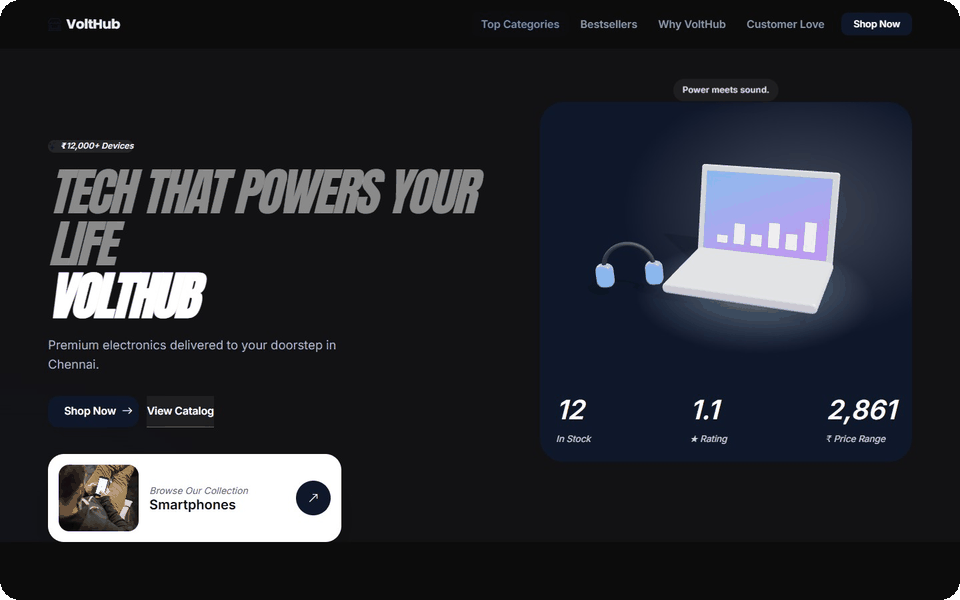
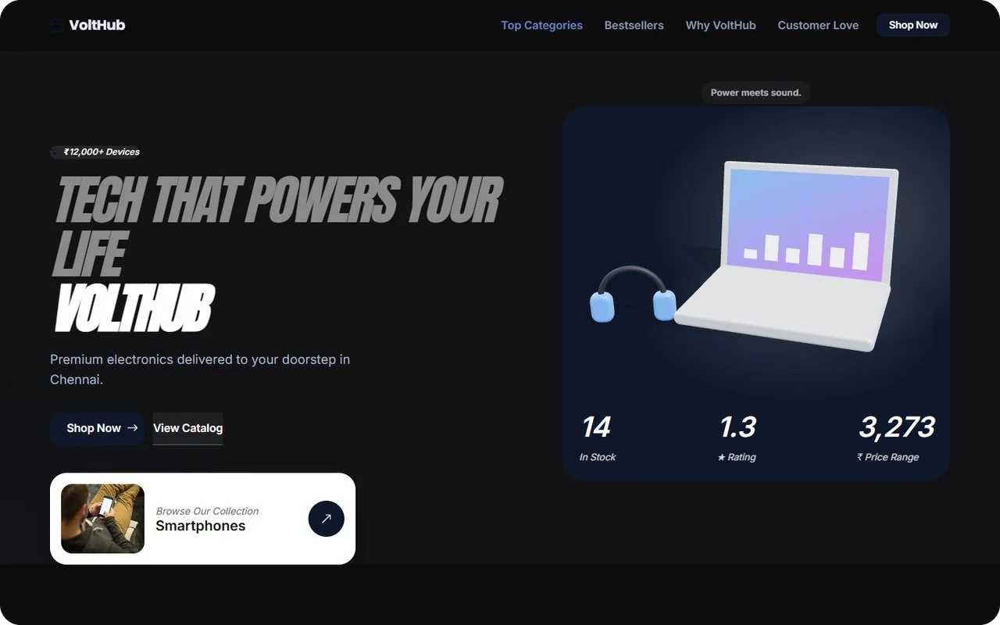
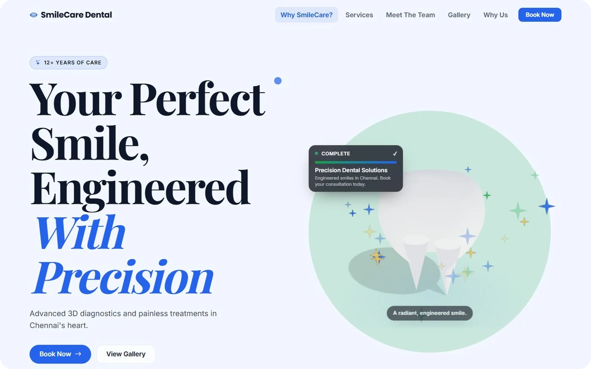
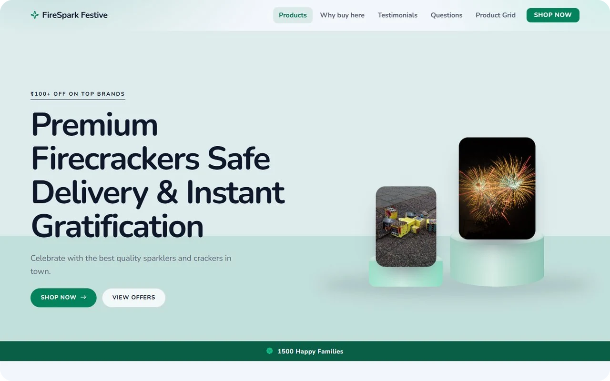

<div align="center">

<picture>
  <source media="(prefers-color-scheme: dark)" srcset="docs/brand/banner-dark.svg">
  <source media="(prefers-color-scheme: light)" srcset="docs/brand/banner-light.svg">
  
</picture>


[**See what it builds**](#-what-it-builds) · [**Install**](#-install) · [**Support the project**](#-support-m42-ui)



<sub>VoltHub: a 3D landing page M42 UI built from one request, in about 15 minutes on my 16 GB PC, CPU only.</sub>

</div>

---

A local AI app that designs and builds web pages and small multi-page sites on your own PC: no cloud model, no
API key. You open a folder, describe the page (or attach a design picture), and M42 UI writes a working site into
that folder (HTML, Bootstrap, its own UI kit), checks it in a headless browser, and changes it when you ask.

It runs one small model, **Qwen3.5-4B** (or **Qwen3.5-2B** on an 8 GB PC), through [llama.cpp](https://github.com/ggml-org/llama.cpp). It is made
for an ordinary CPU (tested on a Ryzen 5 5600G with 16 GB RAM: about 10 tokens/s).

##  Features

| | | |
| :---: | --- | --- |
|  | **Landing pages** | product, shop, clinic, restaurant, event, portfolio pages with real photos, and more |
|  | **3D landing pages** | 3D hero scenes, objects that move and assemble, story in beats (three.js), and more |
|  | **Admin panels** | dashboards, CRM, POS, SaaS admin panels and other common business apps: tables, charts, kanban, forms that work, and more |
|  | **Design from a picture** | attach any design you like (a page, a dashboard, an app screen); its layout and colours are followed |
|  | **Edit by asking** | "make the header dark", "add a pricing section": only that part is rebuilt |
|  | **Checked in a real browser** | links, contrast, phone width and JavaScript errors |
|  | **Voice input** | **Tamil**: AI4Bharat IndicConformer Tamil (Tamil and Tanglish, typed live in Tamil script) · **English and 98 more languages**: Whisper small ([full list](#voice-languages)) |
|  | **Private** | everything stays on your PC |
|  | **And more** | blogs, shops, booking pages, multi-page sites, app screens: describe it, and M42 UI builds it |

<a id="voice-languages"></a>
<details>
<summary> <b>Voice languages: Tamil with IndicConformer, 99 languages with Whisper small</b></summary>

<br>

- **Tamil:** AI4Bharat **IndicConformer Tamil**: very fast, writes Tamil script, understands Tanglish.
- **Whisper small (99 languages, detected on its own):** English, Chinese, German, Spanish, Russian, Korean, French, Japanese, Portuguese, Turkish, Polish, Catalan, Dutch, Arabic, Swedish, Italian, Indonesian, Hindi, Finnish, Vietnamese, Hebrew, Ukrainian, Greek, Malay, Czech, Romanian, Danish, Hungarian, Tamil, Norwegian, Thai, Urdu, Croatian, Bulgarian, Lithuanian, Latin, Maori, Malayalam, Welsh, Slovak, Telugu, Persian, Latvian, Bengali, Serbian, Azerbaijani, Slovenian, Kannada, Estonian, Macedonian, Breton, Basque, Icelandic, Armenian, Nepali, Mongolian, Bosnian, Kazakh, Albanian, Swahili, Galician, Marathi, Punjabi, Sinhala, Khmer, Shona, Yoruba, Somali, Afrikaans, Occitan, Georgian, Belarusian, Tajik, Sindhi, Gujarati, Amharic, Yiddish, Lao, Uzbek, Faroese, Haitian Creole, Pashto, Turkmen, Nynorsk, Maltese, Sanskrit, Luxembourgish, Myanmar, Tibetan, Tagalog, Malagasy, Assamese, Tatar, Hawaiian, Lingala, Hausa, Bashkir, Javanese, Sundanese.

Whisper small is best in English; in languages with less training data it makes more mistakes.

</details>

##  What it builds

Real pages built by M42 UI on my PC (Ryzen 5 5600G, 16 GB RAM, **no graphics card**), shown as they came out.
Each one took **12 to 18 minutes** (about 15 on average) from the request to the finished page. With a graphics
card the model runs on the card, so a build can be faster.

<table>
  <tr>
    <td width="50%"><br> <b>Electronics shop</b> · 3D landing page</td>
    <td width="50%"><br> <b>Dental clinic</b> · 3D landing page</td>
  </tr>
  <tr>
    <td width="50%"><br> <b>Real estate CRM</b> · admin panel</td>
    <td width="50%"><br> <b>Electronics store</b> · e-commerce landing page</td>
  </tr>
  <tr>
    <td width="50%"><br> <b>Dental clinic</b> · landing page</td>
    <td width="50%"><br> <b>Firecrackers shop</b> · landing page</td>
  </tr>
</table>

<div align="center">

**Watch M42 UI build pages, and follow what comes next**

<a href="https://www.youtube.com/@M42TECH"></a>&nbsp;
<a href="https://www.instagram.com/muthupandi20"></a>&nbsp;
<a href="https://m42tech.in"></a>

</div>

##  Support M42 UI

M42 UI is free, and I build it on my own time, on an ordinary PC like yours.

If it helped you, saved you time, or you simply like what it does, a small donation means a lot. It tells me
this work is useful to someone, and that keeps me going: more projects like this one, more kinds of pages,
better 3D, and a faster app on everyday PCs. Every coffee turns into the next feature.

Thank you for being part of it.

<div align="center">

**From anywhere in the world**

<a href="https://buymeacoffee.com/muthupandit"></a>

pay by card, from any country

<br>

**From India (UPI)**


`muthupandi0297@oksbi`

<br>

 Not able to donate? A star on this repository helps others find it.

</div>

## How it works

1. **Open a folder.** Every chat belongs to a folder; the pages are written there and changed there.
2. **Describe the page** ("bakery landing page", "school admin dashboard with attendance and fees"). The model
   writes the page's spec: what it shows, its data, its rules, its layout.
3. **The design reference**, in this order:
   - a picture you attach (a design you like): its layout, look and colours are used, not its content;
   - else an open-source template of that kind on GitHub (its live demo, captured);
   - else M42 UI designs it itself, from bundled design data (palettes, fonts and section orders for 192 kinds
     of product) and the outline of a similar page from the UIGEN-T2 dataset.
4. **The page plan**: the model fills M42's templates and widgets (charts, calendars, tables, pricing, team,
   blog cards, funnel, gantt...). Cards the widget library lacks are written by the model, with a similar
   example from the dataset as a guide.
5. **Photos**: real photos for the hero and the product / menu cards from Pexels or Pixabay (free API keys in Settings; without keys, Openverse photos that allow commercial use), downloaded into the site's `images/` folder so it works offline, and credited in `images/CREDITS.txt` and the footer.
6. **Checks**: classes and links, contrast, phone width, JavaScript errors in a real browser.
7. **Changes**: "make the header dark", "add a pricing section": only that page and section are made again.

##  Install

> [!TIP]
> One installer for Windows, macOS and Linux. It checks your PC, picks the model that fits, shows what it will
> download with the sizes, and **asks before anything downloads**.

### What you need

| | | |
| :---: | --- | --- |
|  | **Memory** | 8 GB RAM works (small model) · **16 GB recommended** (better pages) |
|  | **Processor** | any ordinary CPU · a graphics card with 6 GB or more is used when there is one |
|  | **Disk** | free space for the model and the runner (the installer shows the exact sizes first) |
|  | **Browser** | Chrome, Edge, Chromium or Brave (Windows already has Edge) |
|  | **Python 3.10+** | not installed? the installer offers to install it for you |
|  | **Internet** | only for the first download; after that M42 UI works offline |

### Three steps

<table>
<tr>
<td width="64" align="center"></td>
<td>

**Download M42 UI**

Click the green **Code** button at the top of this page → **Download ZIP**, then unzip it. Or with git:

```bash
git clone https://github.com/M42TECHY/M42-UI.git
```

</td>
</tr>
<tr>
<td width="64" align="center"></td>
<td>

**Run the installer for your system**

| | System | Do this |
| :---: | --- | --- |
|  | **Windows 10 / 11** | double-click `install.bat` |
|  | **macOS** (Apple Silicon, Intel) | double-click `install.command` |
|  | **Linux** (x64, ARM64) | run `sh install.sh` in a terminal |

</td>
</tr>
<tr>
<td width="64" align="center"></td>
<td>

**Say yes, and wait for it to finish**

The installer sets up its own Python environment, checks your PC, picks the model, downloads it and opens
M42 UI. Next time, start it with the launcher:

| | Start M42 UI later |
| :---: | --- |
|  | `Start M42 UI.vbs` |
|  | `Start M42 UI.command` |
|  | `Start M42 UI.sh` (also in the apps menu) |

</td>
</tr>
</table>

> [!NOTE]
> **macOS, first time:** right-click `install.command` → **Open** (macOS asks once for files from the internet).

### Which model does it pick?

| Your PC | Model | |
| --- | --- | --- |
| 8 GB RAM | **Qwen3.5-2B** | smaller and lighter |
| 16 GB RAM, or a graphics card with 6 GB+ | **Qwen3.5-4B** | better pages, reads pictures well |

You can always choose the other one.

<details>
<summary> <b>What the installer does, step by step</b></summary>

<br>

1. Finds Python 3.10+ (or offers to install it: winget, Homebrew, apt / dnf / pacman), makes its own environment
   in `.venv` and installs the packages there (it asks first).
2. Checks this PC: RAM, free disk, graphics card.
3. Picks the model that fits (see the table above).
4. Lists what it will download with the sizes, and asks before anything downloads:
   - llama-server for this system (llama.cpp's release: Vulkan on Windows / Linux for any graphics card, Metal on
     a Mac, the CPU build as the fallback);
   - the model and its picture reader (Hugging Face, GGUF);
   - speech: IndicConformer Tamil (Tamil and Tanglish, typed live as you speak), Whisper small (English and every
     language) and the voice detector.

   Each file is checked by its size and SHA-256, and a broken download resumes when you run it again.
5. Offers the **optional 3D pack** (about 120 MB, "no" by default): about 850 free low-poly models from
   [Polyfork](https://polyfork.dev) (CC BY 4.0) for the 3D landing pages: restaurant, hospital, office, lab,
   university, hotel, city, airport, cars, farm and more. A page that uses one credits it in its footer.
6. Makes the launcher and starts M42 UI.

If you start the app without the installer, it shows the same list in its window and downloads only when you
press Download.

</details>

<details>
<summary> <b>Advanced options</b></summary>

<br>

| Command | What it does |
| --- | --- |
| `python m42/setup.py --yes` | install without questions |
| `python m42/setup.py --tier 2b` or `--tier 4b` | choose the model yourself |
| `python m42/setup.py --no-speech` | skip the speech models |
| `python m42/setup.py --no-start` | install, but do not start the app |
| `python m42/pack3d.py install` | download the optional 3D pack later (`remove` deletes it) |
| `python m42/firstrun.py plan` | show this PC and what it would download |

**Optional extras**
- `models/UI-DETR-1/model.pth` (racineai/UI-DETR-1): finds the cards in a reference picture more reliably
  (needs `torch` and `rfdetr`).
- The UIGEN-T2 examples: `python m42/uiexamples.py download` then `python m42/uiexamples.py build`.

</details>

## Folders

```
M42-UI/
  m42/          the app (Python server + the window's HTML/JS)
  m42/bundled/  the UI kit copied into every site (Bootstrap, icons, m42-ui.css/js) and the design data
  models/       model files (not in the repository)
  llama.cpp/    llama-server (downloaded by the installer)
  whisper.cpp/  whisper-server for speech (downloaded by the installer)
  .venv/        the installer's Python environment
  knowledge/    the UIGEN-T2 examples index (optional, not in the repository)
```

## Licence

See `THIRD_PARTY_NOTICES.md` for the bundled libraries and data and for the models and datasets you download.

README icons: [Lucide](https://lucide.dev) (ISC licence, `docs/icons/LICENSE-lucide.txt`).
