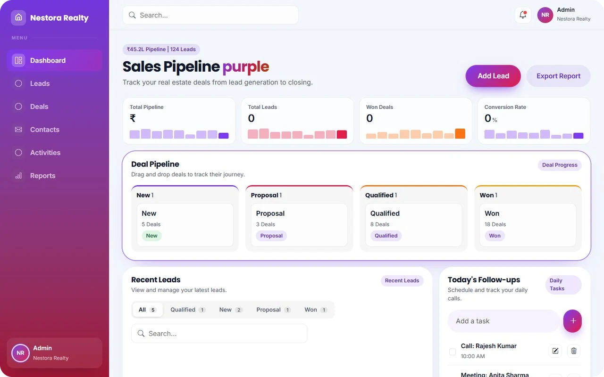
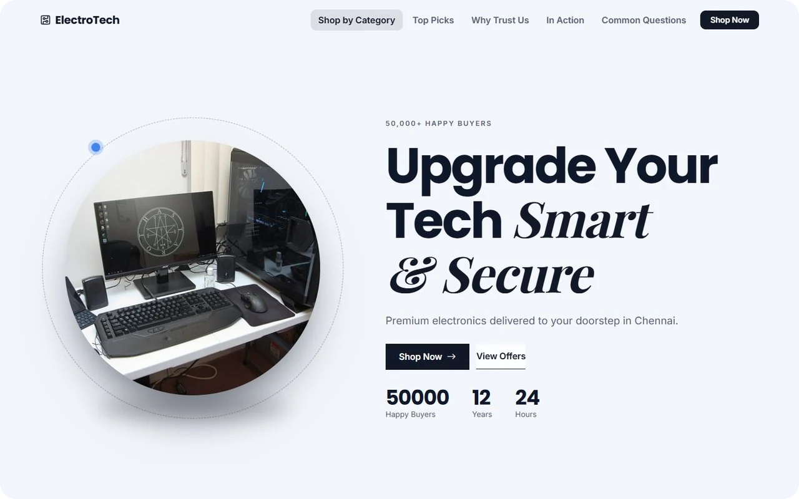
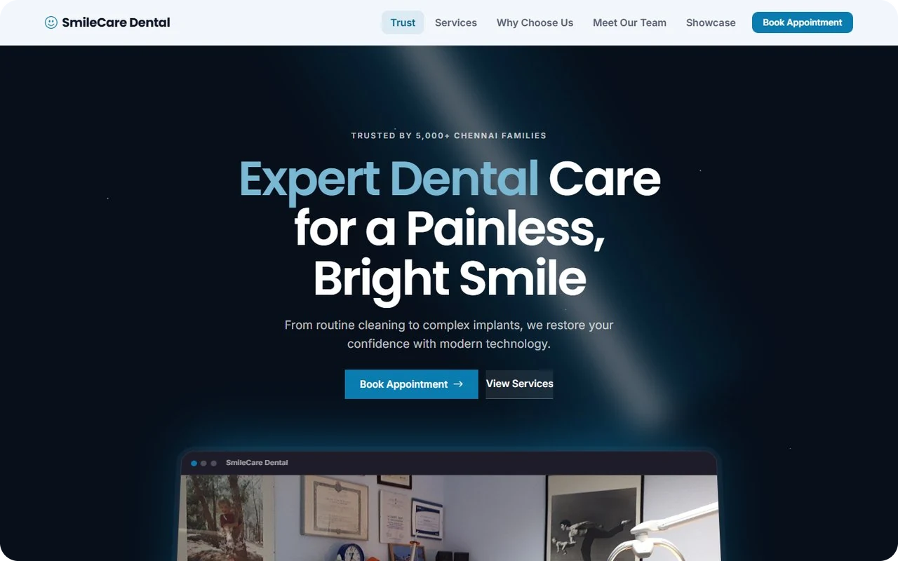

<div align="center">

<picture>
  <source media="(prefers-color-scheme: dark)" srcset="docs/brand/banner-dark.svg">
  <source media="(prefers-color-scheme: light)" srcset="docs/brand/banner-light.svg">
  
</picture>


[**See what it builds**](#-what-it-builds) · [**Install**](#install-windows-linux-macos) · [**Support the project**](#-support-m42-ui)


</div>

---

A local AI app that designs and builds web pages and small multi-page sites on your own PC: no cloud model, no
API key. You open a folder, describe the page (or attach a design picture), and M42 UI writes a working site into
that folder (HTML, Bootstrap, its own UI kit), checks it in a headless browser, and changes it when you ask.

It runs one small model, **Qwen3.5-4B** (or **Qwen3.5-2B** on an 8 GB PC), through [llama.cpp](https://github.com/ggml-org/llama.cpp). It is made
for an ordinary CPU (tested on a Ryzen 5 5600G with 16 GB RAM: about 10 tokens/s).

##  Features

| | | |
| :---: | --- | --- |
|  | **Landing pages** | product, shop, clinic, restaurant, event pages with real photos |
|  | **3D landing pages** | 3D hero scenes and motion, built with three.js |
|  | **Admin panels** | dashboards, CRM, POS: tables, charts, kanban, forms that work |
|  | **Design from a picture** | attach a design you like; its layout and colours are followed |
|  | **Edit by asking** | "make the header dark", "add a pricing section": only that part is rebuilt |
|  | **Checked in a real browser** | links, contrast, phone width and JavaScript errors |
|  | **Voice input** | speak in Tamil, Tanglish or English |
|  | **Private** | everything stays on your PC |

##  What it builds

Real pages built by M42 UI on a 16 GB PC, shown as they came out.

<table>
  <tr>
    <td width="50%"><br> <b>Electronics shop</b> · 3D landing page</td>
    <td width="50%"><br> <b>Dental clinic</b> · 3D landing page</td>
  </tr>
  <tr>
    <td width="50%"><br> <b>Real estate CRM</b> · admin panel</td>
    <td width="50%"><br> <b>Electronics store</b> · e-commerce landing page</td>
  </tr>
  <tr>
    <td width="50%"><br> <b>Dental clinic</b> · landing page</td>
    <td width="50%"><br> <b>Firecrackers shop</b> · landing page</td>
  </tr>
</table>

## How it works

1. **Open a folder.** Every chat belongs to a folder; the pages are written there and changed there.
2. **Describe the page** ("bakery landing page", "school admin dashboard with attendance and fees"). The model
   writes the page's spec: what it shows, its data, its rules, its layout.
3. **The design reference**, in this order:
   - a picture you attach (a design you like): its layout, look and colours are used, not its content;
   - else an open-source template of that kind on GitHub (its live demo, captured);
   - else M42 UI designs it itself, from bundled design data (palettes, fonts and section orders for 192 kinds
     of product) and the outline of a similar page from the UIGEN-T2 dataset.
4. **The page plan**: the model fills M42's templates and widgets (charts, calendars, tables, pricing, team,
   blog cards, funnel, gantt...). Cards the widget library lacks are written by the model, with a similar
   example from the dataset as a guide.
5. **Photos**: real photos for the hero and the product / menu cards from Pexels or Pixabay (free API keys in Settings; without keys, Openverse photos that allow commercial use), downloaded into the site's `images/` folder so it works offline, and credited in `images/CREDITS.txt` and the footer.
6. **Checks**: classes and links, contrast, phone width, JavaScript errors in a real browser.
7. **Changes**: "make the header dark", "add a pricing section": only that page and section are made again.

## Install (Windows, Linux, macOS)

Download this repository (Code → Download ZIP, or `git clone`), then run the installer for your system:

| System | Run |
| --- | --- |
| Windows 10 / 11 | double-click `install.bat` |
| Linux (x64, ARM64) | `sh install.sh` |
| macOS (Apple Silicon, Intel) | double-click `install.command` (first time: right-click → Open) |

The installer:

1. finds Python 3.10+ (or offers to install it: winget, Homebrew, apt / dnf / pacman), makes its own environment
   in `.venv` and installs the packages there (it asks first);
2. checks this PC: RAM, free disk, graphics card;
3. picks the model that fits: **Qwen3.5-2B** on an 8 GB PC, **Qwen3.5-4B** from 16 GB RAM or with a graphics card
   of 6 GB or more (you can choose the other one);
4. lists what it will download with the sizes and asks before anything downloads:
   - llama-server for this system (llama.cpp's release: Vulkan on Windows / Linux for any graphics card, Metal on
     a Mac, the CPU build as the fallback);
   - the model and its picture reader (Hugging Face, GGUF);
   - speech: Whisper small (every language) and the Whisper Tanglish test model, and the voice detector;
   each file is checked by its size and SHA-256, and a broken download resumes when you run it again;
5. makes the launcher and starts M42 UI.

Start it later with `Start M42 UI.vbs` (Windows), `Start M42 UI.sh` (Linux, also in the apps menu) or
`Start M42 UI.command` (macOS). If you start the app without the installer, it shows the same list in its window
and downloads only when you press Download.

Options: `python m42/setup.py --yes` (no questions), `--tier 2b|4b`, `--no-speech`, `--no-start`;
`python m42/firstrun.py plan` shows this PC and what it would download.

Optional extras:
- `models/UI-DETR-1/model.pth` (racineai/UI-DETR-1): finds the cards in a reference picture more reliably
  (needs `torch` and `rfdetr`).
- The UIGEN-T2 examples: `python m42/uiexamples.py download` then `python m42/uiexamples.py build`.
- Google Chrome, Chromium, Edge or Brave for the app window and the page checks (Windows has Edge already).

## Folders

```
M42-UI/
  m42/          the app (Python server + the window's HTML/JS)
  m42/bundled/  the UI kit copied into every site (Bootstrap, icons, m42-ui.css/js) and the design data
  models/       model files (not in the repository)
  llama.cpp/    llama-server (downloaded by the installer)
  whisper.cpp/  whisper-server for speech (downloaded by the installer)
  .venv/        the installer's Python environment
  knowledge/    the UIGEN-T2 examples index (optional, not in the repository)
```

##  Support M42 UI

M42 UI is free, and I build it on my own time, on an ordinary PC like yours.

If it helped you, saved you time, or you simply like what it does, a small donation means a lot. It tells me
this work is useful to someone, and that keeps me going: more projects like this one, more kinds of pages,
better 3D, and a faster app on everyday PCs. Every coffee turns into the next feature.

Thank you for being part of it.

<div align="center">

**From anywhere in the world**

<a href="https://buymeacoffee.com/muthupandit"></a>

pay by card, from any country

<br>

**From India (UPI)**


`muthupandi0297@oksbi`

<br>

 Not able to donate? A star on this repository helps others find it.

</div>

## Licence

See `THIRD_PARTY_NOTICES.md` for the bundled libraries and data and for the models and datasets you download.

README icons: [Lucide](https://lucide.dev) (ISC licence, `docs/icons/LICENSE-lucide.txt`).
